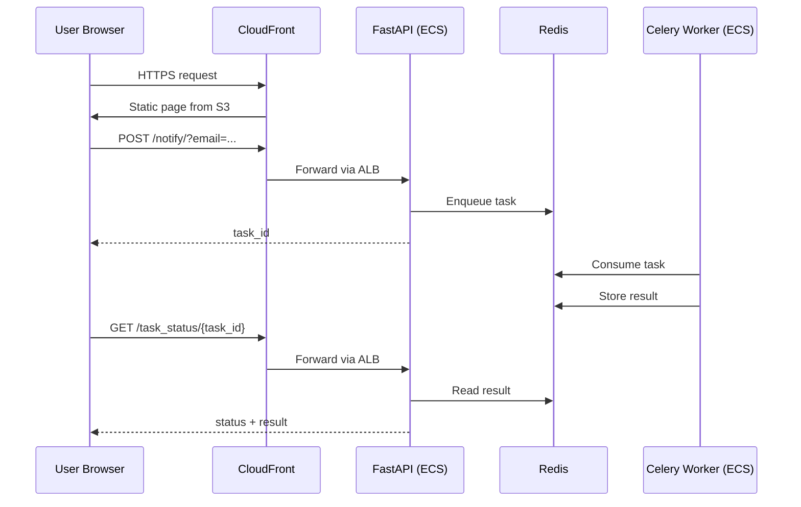
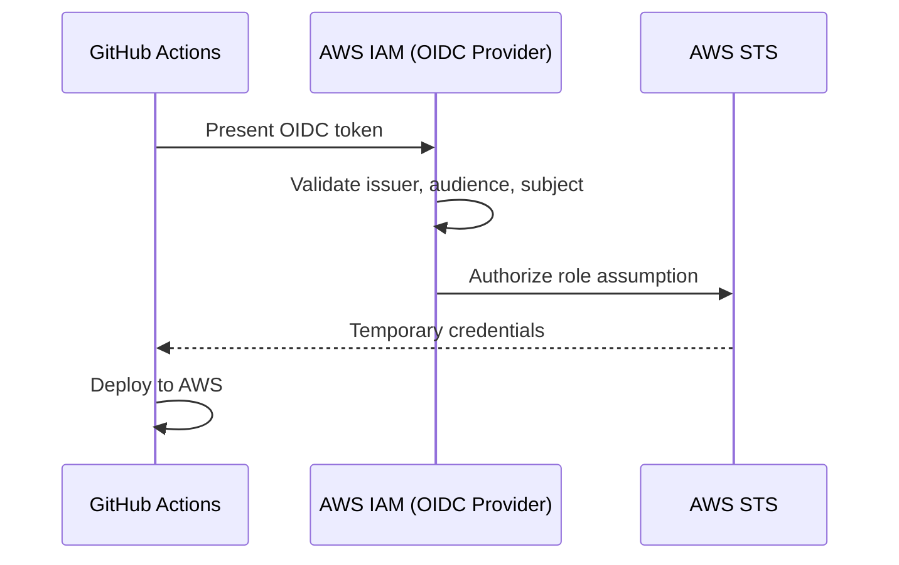

<div align="center">

# 🚀 Notifier — End-to-End DevOps Deployment on AWS

**A production-style DevOps project that containerizes, provisions, deploys and monitors an asynchronous notification system on AWS using Terraform and GitHub Actions.**

[](https://aws.amazon.com/)
[](https://www.terraform.io/)
[](https://www.docker.com/)
[](https://github.com/features/actions)
[](https://fastapi.tiangolo.com/)
[](https://docs.celeryq.dev/)
[](https://redis.io/)
[](#%EF%B8%8F-aws-infrastructure)

[Architecture](#%EF%B8%8F-architecture) · [Screenshots](#-proof-of-deployment) · [Quick Start](#-run-locally) · [CI/CD](#-cicd-pipeline) · [Cleanup](#-infrastructure-cleanup)

</div>

---

## 📌 Table of Contents

1. [Overview](#-overview)
2. [Key Highlights](#-key-highlights)
3. [Architecture](#%EF%B8%8F-architecture)
4. [Tech Stack](#%EF%B8%8F-tech-stack)
5. [Application Workflow](#-application-workflow)
6. [Repository Structure](#-repository-structure)
7. [Prerequisites](#-prerequisites)
8. [Run Locally](#-run-locally)
9. [AWS Infrastructure](#%EF%B8%8F-aws-infrastructure)
10. [Terraform Deployment](#%EF%B8%8F-terraform-deployment)
11. [CI/CD Pipeline](#-cicd-pipeline)
12. [GitHub OIDC Authentication](#-github-oidc-authentication)
13. [Testing](#-testing)
14. [Monitoring and Logging](#-monitoring-and-logging)
15. [Security](#%EF%B8%8F-security)
16. [Proof of Deployment](#-proof-of-deployment)
17. [Environment Variables](#-environment-variables)
18. [Troubleshooting](#-troubleshooting)
19. [Infrastructure Cleanup](#-infrastructure-cleanup)
20. [Future Improvements](#-future-improvements)
21. [Project Deliverables](#-project-deliverables)
22. [Author](#-author)

---

## 📖 Overview

Notifier is a distributed background-processing application built with **FastAPI**, **Celery** and **Redis**. This project takes the application from source code to a fully automated cloud deployment:

- The app is **containerized** with Docker.
- All AWS infrastructure is **provisioned as code** with Terraform.
- Every push to `main` **builds, tests and deploys** through GitHub Actions.
- GitHub authenticates to AWS using **OIDC**, so there are no long-lived access keys.
- Logs and metrics are centralized in **Amazon CloudWatch**.

> **Note:** This is a demonstration of background task processing. It simulates sending notifications and does not send real emails.

## ✨ Key Highlights

| | Feature | Detail |
|---|---|---|
| 🐳 | Containerized | One image for the backend and the Celery worker, different start commands |
| 🏗️ | Infrastructure as Code | VPC, ECS, ECR, ElastiCache, S3, CloudFront, IAM, all in Terraform |
| 🔁 | Fully automated CI/CD | Validate → build → scan → push → apply → deploy → smoke test |
| 🔐 | Keyless AWS access | GitHub OIDC with short-lived IAM role credentials |
| ☁️ | Serverless containers | ECS Fargate, no EC2 hosts to manage |
| 🔒 | Encrypted Redis | ElastiCache with TLS in transit and an auth token |
| 📊 | Observability | CloudWatch Logs, alarms and ECS health checks |
| ✅ | Verified deploys | Automated smoke test after every release |

---

## 🏗️ Architecture

<div align="center">


*End-to-end architecture: GitHub → CI/CD → AWS (CloudFront, S3, ALB, ECS Fargate, ElastiCache Redis, ECR, CloudWatch)*

</div>

### Component Summary

| Component | AWS Service | Purpose |
|---|---|---|
| Frontend | Amazon S3 | Static website hosting |
| CDN | Amazon CloudFront | HTTPS delivery and API routing |
| Load Balancer | Application Load Balancer | Routes API traffic to the backend |
| Backend | ECS Fargate | Runs the FastAPI service |
| Worker | ECS Fargate | Runs Celery background tasks |
| Registry | Amazon ECR | Stores Docker images |
| Broker / Result store | ElastiCache Redis | Task queue and results (TLS) |
| Networking | Amazon VPC | Public and private subnet isolation |
| Secrets | AWS Secrets Manager | Redis connection settings |
| Logging | CloudWatch Logs | Centralized logs and alarms |
| IaC | Terraform | Infrastructure provisioning |
| CI/CD | GitHub Actions | Build and deployment automation |

---

## 🛠️ Tech Stack

| Category | Technologies |
|---|---|
| Language | Python |
| Backend | FastAPI |
| Background jobs | Celery |
| Broker / backend | Redis |
| Frontend | HTML, CSS, JavaScript |
| Containers | Docker, Docker Compose |
| Cloud | AWS (ECS Fargate, ECR, ElastiCache, S3, CloudFront, ALB, VPC, IAM, Secrets Manager, CloudWatch) |
| IaC | Terraform |
| CI/CD | GitHub Actions, GitHub OIDC |
| Version control | Git, GitHub |

---

## 🔄 Application Workflow



1. The user submits an email address in the frontend.
2. The frontend calls `POST /notify/?email=user@example.com`.
3. FastAPI enqueues a Celery task in Redis and returns a `task_id`.
4. The Celery worker consumes the task and processes it asynchronously.
5. The result is stored in Redis.
6. The frontend polls `GET /task_status/{task_id}` and displays the result.

---

## 📁 Repository Structure

```text
devops-assignment/
├── backend/
│   ├── main.py                # FastAPI application
│   ├── worker.py              # Celery worker
│   ├── requirements.txt
│   └── Dockerfile
├── frontend/
│   └── index.html
├── infra/
│   ├── bootstrap/             # State bucket and GitHub OIDC role
│   ├── main.tf
│   ├── variables.tf
│   ├── outputs.tf
│   ├── providers.tf
│   ├── network.tf
│   ├── ecs.tf
│   ├── redis.tf
│   ├── ecr.tf
│   ├── frontend.tf
│   ├── iam.tf
│   └── backend.hcl
├── nginx/
│   └── default.conf
├── scripts/
│   └── smoke_test.sh
├── .github/workflows/
│   └── deploy.yml
├── docker-compose.yml
├── .env.example
├── journey.md
├── instructions.md
└── README.md
```

---

## 💻 Prerequisites

| Tool | Purpose |
|---|---|
| Git | Source control |
| Docker and Docker Compose v2 | Containers and local orchestration |
| Python 3 | Optional local development |
| AWS CLI | AWS management |
| Terraform >= 1.10 | Infrastructure provisioning |
| GitHub account | Repository and CI/CD |

```bash
git --version && docker --version && docker compose version
python3 --version && aws --version && terraform version
```

---

## 🐳 Run Locally

```bash
# 1. Clone
git clone https://github.com/Anand9340/devops-assignment.git
cd devops-assignment

# 2. Configure environment (never commit .env)
cp .env.example .env

# 3. Build and start
docker compose build
docker compose up -d

# 4. Check status and logs
docker compose ps
docker compose logs -f
```

| Service | URL |
|---|---|
| Frontend | http://localhost:8080 |
| API docs (Swagger) | http://localhost:8000/docs |

```bash
# Stop
docker compose down

# Stop and delete local volumes
docker compose down -v
```

See [instructions.md](instructions.md) for the full local setup guide.

---

## ☁️ AWS Infrastructure

**Region:** `ap-south-1` (Mumbai)

| Resource | Role |
|---|---|
| **VPC** (`10.0.0.0/16`) | Isolated network with public and private subnets |
| **Application Load Balancer** | Routes API traffic to the backend service |
| **ECS Fargate** | Runs the FastAPI backend and Celery worker |
| **Amazon ECR** | Stores the application image |
| **ElastiCache Redis** | Managed Redis in private subnets, TLS and auth token enabled |
| **S3** | Hosts the static frontend |
| **CloudFront** | HTTPS delivery for the frontend and API routing |
| **Secrets Manager** | Stores Redis connection configuration |
| **CloudWatch** | Logs, metrics and alarms |
| **IAM** | Task roles, execution roles and the GitHub OIDC deploy role |

---

## ⚙️ Terraform Deployment

> The automated GitHub Actions pipeline is the preferred deployment path. Use the manual steps below for first-time setup or debugging.

```bash
aws configure
aws sts get-caller-identity      # verify identity

cd infra
terraform init -backend-config=backend.hcl
terraform fmt -check
terraform validate
terraform plan
terraform apply
terraform output                 # app URL, ALB DNS, ECR URL, CloudFront ID
```

---

## 🔁 CI/CD Pipeline

```mermaid
flowchart LR
    A[Push to main] --> B[Checkout]
    B --> C[Terraform validate]
    C --> D[Docker build]
    D --> E[Security checks]
    E --> F[OIDC auth to AWS]
    F --> G[Push image to ECR]
    G --> H[Terraform apply]
    H --> I[Deploy ECS services]
    I --> J[Sync frontend to S3]
    J --> K[Invalidate CloudFront]
    K --> L[Smoke test]
```



| Stage | Description |
|---|---|
| Validation | Terraform format and validate checks |
| Build | Builds the application container image |
| Security checks | Application and image checks |
| Authentication | Assumes the AWS deploy role via OIDC |
| Image push | Pushes the image to ECR |
| Infrastructure | Applies the Terraform plan |
| ECS deployment | Updates the backend and worker services |
| Frontend | Syncs files to S3 and invalidates CloudFront |
| Smoke test | Verifies health and API behavior |

Deploy by pushing to `main`, then watch the **Actions** tab:

```bash
git add .
git commit -m "Update application deployment"
git push origin main
```

---

## 🔐 GitHub OIDC Authentication

GitHub Actions receives **temporary** AWS credentials by assuming an IAM role, so no access keys are stored in GitHub.



Required workflow permissions:

```yaml
permissions:
  id-token: write
  contents: read
```

Store the IAM role ARN as the repository secret `AWS_ROLE_ARN`.

**Benefits:** no long-lived keys, short-lived credentials, role-based access, and trust limited to this repository.

---

## 🧪 Testing

```bash
# Health check
curl -i https://YOUR_APPLICATION_DOMAIN/health

# Submit a notification
curl -i -X POST "https://YOUR_APPLICATION_DOMAIN/notify/?email=smoke@example.com"

# Check task status
curl "https://YOUR_APPLICATION_DOMAIN/task_status/TASK_ID"

# Run the automated smoke test
./scripts/smoke_test.sh https://YOUR_APPLICATION_DOMAIN
```

Expected final status response:

```json
{
  "task_id": "TASK_ID",
  "status": "completed",
  "result": "Task completed: Notification sent to smoke@example.com"
}
```

Verify the ECS services:

```bash
aws ecs describe-services \
  --cluster notifier \
  --services backend worker \
  --region ap-south-1 \
  --query 'services[*].{Service:serviceName,Desired:desiredCount,Running:runningCount,Status:status}' \
  --output table
```

---

## 📊 Monitoring and Logging

```bash
aws logs tail /ecs/notifier/backend --region ap-south-1 --follow
aws logs tail /ecs/notifier/worker  --region ap-south-1 --follow
```

Monitored signals: backend logs, Celery worker logs, ECS service health, container CPU and memory, CloudWatch alarms, and health-check status.

---

## 🛡️ Security

| Area | Implementation |
|---|---|
| AWS authentication | GitHub OIDC, no static keys |
| Access control | Least-privilege IAM roles |
| Secrets | AWS Secrets Manager |
| Redis | TLS in transit, auth token, private subnets |
| Network | VPC and security groups |
| Frontend delivery | CloudFront HTTPS |
| Terraform state | Remote state backend |
| Logging | CloudWatch Logs |

**Best practices followed:** never commit `.env`, credentials or Terraform state; keep Redis private; allow Redis access only from application security groups; rotate any exposed secrets.

---

## 📸 Proof of Deployment

Screenshots from the live AWS deployment.

### 1. Application running on CloudFront

| Frontend UI | Task completed |
|---|---|
|  |  |

### 2. GitHub Actions pipeline


### 3. Terraform apply


### 4. ECS Fargate services


### 5. ECR image repository


### 6. ElastiCache Redis


### 7. CloudFront distribution and S3 frontend

| CloudFront | S3 bucket |
|---|---|
|  |  |

### 8. CloudWatch logs

| Backend logs | Worker logs |
|---|---|
|  |  |

---

## 🔧 Environment Variables

| Variable | Purpose |
|---|---|
| `REDIS_URL` | Redis connection URL |
| `CELERY_BROKER_URL` | Celery message broker |
| `CELERY_RESULT_BACKEND` | Celery result storage |
| `TASK_DELAY_SECONDS` | Simulated task processing delay |
| `CORS_ORIGINS` | Allowed frontend origins |

Local development uses the Docker Compose Redis service. In AWS, Redis settings are read from Secrets Manager. See `.env.example` for the local configuration.

---

## 🧰 Troubleshooting

| Problem | Likely cause | Action |
|---|---|---|
| Container exits | Startup or config error | `docker compose logs` |
| Health check fails | Wrong endpoint or port | Verify `/health` and the container port |
| `/notify` returns 500 | Redis or Celery config | Check backend CloudWatch logs |
| Task stuck in progress | Worker down or no Redis access | Check worker logs and Redis connectivity |
| ECS task fails to start | Missing image or config | Check the stopped-task reason |
| ECR pull fails | Wrong image URI or role permissions | Verify the repository and execution role |
| OIDC auth fails | Trust policy or missing `id-token: write` | Verify audience, subject and workflow permissions |
| Terraform init fails | Bad backend config | Check `backend.hcl` and the state bucket |
| State lock error | Another operation is running | Confirm before unlocking |
| Frontend not updating | CloudFront cache | Check the invalidation status |
| API fails via CloudFront | Origin behavior or forwarding | Review CloudFront behaviors |

---

## 💰 Infrastructure Cleanup

AWS resources keep generating charges while running. Destroy them after your demo:

```bash
cd infra
terraform plan -destroy
terraform destroy
```

> ⚠️ Destroy the **bootstrap** resources (state bucket, OIDC role) only after the application infrastructure is gone and you no longer need the remote state. Keep a backup of the state first.

---

## 🚀 Future Improvements

- [ ] ECS Service Auto Scaling
- [ ] Custom domain with Route 53 and ACM certificates
- [ ] More comprehensive automated tests
- [ ] CloudWatch dashboards and richer alarms
- [ ] Structured logging and distributed tracing
- [ ] Separate dev, staging and production environments
- [ ] Automated dependency and image vulnerability reports
- [ ] Deployment approval gates
- [ ] Backup and disaster-recovery procedures

---

## 📦 Project Deliverables

| Deliverable | Description |
|---|---|
| Source code | FastAPI backend, Celery worker, frontend |
| Dockerfile and Compose | Container build and local environment |
| Terraform | AWS infrastructure |
| GitHub Actions | Automated CI/CD |
| OIDC | Keyless GitHub-to-AWS authentication |
| `README.md` | Main documentation |
| `instructions.md` | Local setup guide |
| `journey.md` | Engineering decisions and challenges |
| Architecture diagram | See the [Architecture](#%EF%B8%8F-architecture) section |
| Video walkthrough | Demo of the application and deployment |

---

## 👨‍💻 Author

**Anand Singh** — Junior DevOps / Cloud Engineer

Interested in AWS, DevOps automation, containerization, Infrastructure as Code, CI/CD and cloud-native technologies.

[](https://github.com/Anand9340)
[](https://github.com/Anand9340/devops-assignment)

---

<div align="center">

**Building reliable infrastructure. Automating deployments. Delivering cloud-native applications.**

⭐ If you found this project useful, consider giving it a star.

</div>
