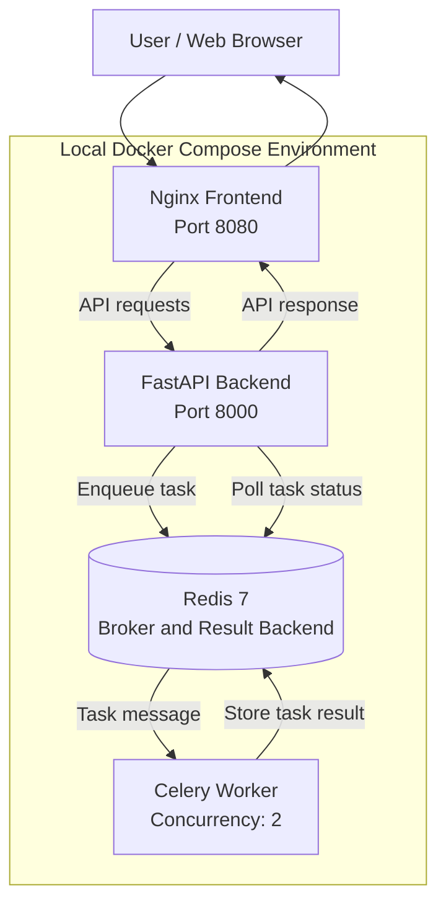
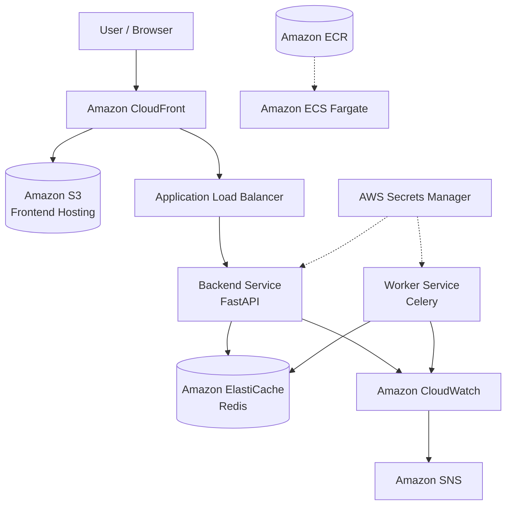
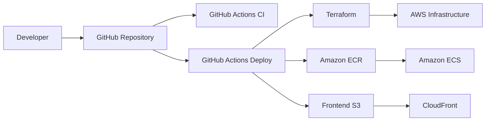

# System Architecture

## 1. Application Overview

The Notifier application accepts notification requests through a web interface, processes them asynchronously using Celery, and uses Redis as its message broker and result backend.

## 2. Local Development Architecture

## 3. AWS Cloud Architecture

## 4. Infrastructure Provisioning and CI/CD

## 5. Main AWS Components

| Component | Purpose |
|---|---|
| Amazon VPC | Network isolation |
| Public and private subnets | Network segmentation |
| Application Load Balancer | Routes API traffic |
| Amazon ECS Fargate | Runs backend and worker containers |
| Amazon ECR | Stores Docker images |
| Amazon ElastiCache Redis | Managed message broker and result backend |
| AWS Secrets Manager | Stores Redis connection credentials |
| Amazon S3 | Hosts frontend files |
| Amazon CloudFront | Delivers frontend and API traffic |
| Amazon CloudWatch | Logs and monitoring |
| Amazon SNS | Notifications from monitoring |
| Terraform | Infrastructure as Code |
| GitHub Actions | CI/CD automation |

## 6. Application Request Flow

1. User opens the frontend through CloudFront.
2. Frontend sends a notification request to the API.
3. CloudFront forwards API traffic through the Application Load Balancer.
4. FastAPI receives the request and submits a Celery task.
5. Redis stores the task message.
6. Celery worker processes the task.
7. Worker stores the task result in Redis.
8. Frontend polls the task-status endpoint.
9. FastAPI retrieves the task status and returns it to the frontend.

**Note:** The current application simulates notification processing. It does not send real emails.
